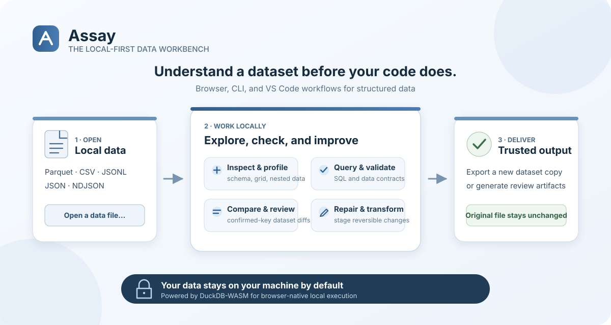

# Assay

> Understand any dataset before your code does.



Assay is **the local-first data workbench**: inspect, understand,
validate, compare, repair, transform, review, and govern structured datasets
(Parquet, JSONL, JSON and CSV), with browser, CLI and desktop VS Code workflows —
dataset contents stay on your machine by default, with a long-term path toward governed data
products and an enterprise data control plane.

**Status: MVP feature milestones complete (M0–M6, closed 2026-09-21).** The
local-first core — inspect, nested data, edit, export, validate, and diff,
with exact agreement between the browser app and the CLI — works end-to-end;
pipeline P1–P3 and local DCR generation are implemented, and desktop VS Code
supports offline viewing, session-only overlay editing and undo/redo, safe new-file export,
validation, confirmed-key diff and Git workflows (slice 2 closed 2026-10-19).
The web usability/visual programme and its audit follow-up are also complete.
Next: human-gated launch readiness (G0); current push and remote-CI observations are recorded in the
[handoff](docs/process/handoff.md). See the
[execution roadmap](docs/product/03-execution-roadmap.md) and the
[post-MVP track](docs/product/04-post-mvp-track.md).

**Picking the project up (handoff/onboarding)? Start with the
[project handoff](docs/process/handoff.md)** — current state, decisions,
environment setup (including quirks), and the concrete next tasks.

## Quickstart

Assay is **not published to npm yet** — the `@assay` npm org claim is still
pending (manual action M1), so the only install path today is a source checkout
of this repository.

```bash
pnpm install   # development requires Node 24 (tested 24.13.0; see .node-version); pnpm via corepack
pnpm dev       # start the web app
```

Development requires **Node 24** (root policy `^24.0.0`, tested 24.13.0). The shipped CLI,
extension, web app and library manifests declare the same `node: ">=24"` line — the earlier `>=22`
floor was never exercised and was narrowed on 2026-11-21 rather than left unverified; the full
constraint table is the [node support contract](docs/process/handoff/20261120-node-support-contract.md).

Every other task is a root script: `pnpm build`, `pnpm typecheck`, `pnpm lint`, `pnpm test`
(unit), `pnpm test:e2e` (Playwright), `pnpm format`, `pnpm changeset`, and
`bash fixtures/parquet/generate.sh` (regenerate Parquet fixtures). For a local preflight, run
**`pnpm run doctor`** (offline: Node/pnpm/install/DuckDB/Playwright/VS Code/test ports); the
bounded `pnpm current-state:check` and `pnpm assurance-map:check` guard documentation facts and the
test-assurance map, and `pnpm measure:bundle` reports bundle/package sizes after a build. The full
command table with descriptions is the single source of truth at
[AGENTS.md § Commands](AGENTS.md#commands).

**Telemetry:** see [Telemetry and your privacy](docs/telemetry-disclosure.md) for what is
collected and how to opt out.

## Command-line interface

The `assay` CLI shares the core packages with the browser app (ADR 0008) and runs
against raw dataset files over the engine's `./node` seam. Build it from a source
checkout, then run the compiled entry:

```bash
pnpm build
cd apps/cli
node --import tsx dist/index.js --help
node --import tsx dist/index.js profile ../../fixtures/csv/customers.csv
```

The `--import tsx` loader is required from this source checkout: the workspace
packages export their `src/*.ts` entry points, so plain Node cannot resolve the
engine package the engine-backed commands import. Full command reference
(options, report formats, exit codes) lives in
[apps/cli/README.md](apps/cli/README.md).

## Documentation

Start at [`docs/README.md`](docs/README.md). Highlights:

- [Product roadmap (vision, phases 0–7)](docs/product/00-roadmap.md)
- [Execution roadmap (canonical sequencing, gates, risks)](docs/product/03-execution-roadmap.md)
- [MVP scope and acceptance criteria](docs/product/02-mvp-scope-and-acceptance.md)
- [Architecture](docs/architecture/01-architecture.md) · [Pipeline/DAG/ETL](docs/architecture/02-pipeline-dag-etl.md)
- [Tech stack](docs/engineering/01-tech-stack.md) · [Repository structure](docs/engineering/03-repository-structure.md)
- [ADRs](docs/adr/README.md) (generated decision index)
- [Documentation & setup review (2026-09-14)](docs/reviews/2026-09-14-documentation-and-setup-review.md)

## Repository layout

```text
apps/        web (Vite/React), cli, vscode (desktop MVP workflow; slice 2 complete)
packages/    domain, core, ui, grid, engine family
             (engine + engine-duckdb + engine-parquet),
             data-sources,
             validation, diff, transforms, contracts, security,
             ai, pipeline, telemetry, testing
fixtures/    golden datasets for tests
docs/        product / architecture / engineering / process / reviews / adr
```

Authoritative layout and package responsibilities live in
[engineering/03-repository-structure.md](docs/engineering/03-repository-structure.md).

## Contributing

See [CONTRIBUTING.md](CONTRIBUTING.md). Durable decisions are recorded as
[ADRs](docs/adr/README.md). To report a security issue privately, see
[SECURITY.md](SECURITY.md).

## License

Vendored development skills retain their upstream MIT notices; see
[skill provenance](.dsh/skills/PROVENANCE.md). They are optional tooling, not application dependencies.

[AGPL-3.0-or-later](LICENSE) — decision record: [ADR 0036](docs/adr/0036-agpl-license.md).
The open core is free software; hosted collaboration and enterprise surfaces
may be licensed separately (open-core model, [ADR 0010](docs/adr/0010-open-core-commercial-boundary.md)).
