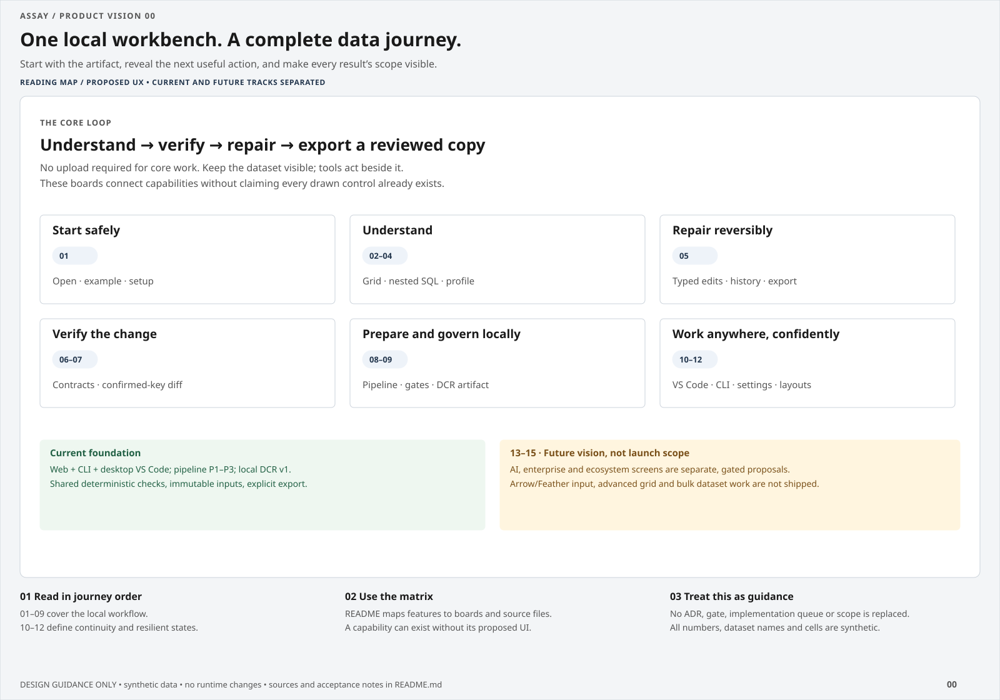

# Assay — comprehensive product / UX vision

**Design guidance, not screenshots or implementation approval.** Reviewed against repository snapshot `bba491a` and the current [handoff](../../docs/process/handoff.md). Three read-only scouts used **`openai-codex/gpt-6-luna`** to inspect the workbench, quality/pipeline/DCR, and setup/surface capabilities. This is a source/documentation audit, not a fresh runtime feature-acceptance run.

Files intentionally live in repository-root **`assests/svg/`**, preserving the requested spelling. Open the SVGs directly in a browser or vector editor; they are self-contained, editable text/vector artwork, with no external fonts, images, scripts, or dataset dependencies. The atlas links to other boards when opened standalone.

## Implementation handoff

**Current pickup (2026-11-10):** [audited follow-up plan](../../docs/reviews/2026-11-10-web-svg-followup-audit.md) → [implementation map/decision gates](../../docs/process/handoff/20261110-web-followup-map.md) → [implementation specification](../../docs/product/14-web-interface-followup-spec.md) → [next-agent briefs](../../docs/process/handoff/20261110-web-followup-pickups.md). **Partially executed 2026-11-10:** the selected subset landed — pipeline label honesty (WF-02, `b65e304`), exact-precision
temporal display (WF-01, `b6b773d`), the read-only temporal matrix (WF-01P) and a verified replacement contract (WF-05 v5,
with [ADR 0047](../../docs/adr/0047-web-session-replacement-retains-retired-tables.md) settling table lifetime) — and
WF-10 closed that subset. Everything else in the atlas is still unselected: WF-03/04/07 need their WFD decisions, WF-06
needs an explicit runtime go, and WF-08/09/WF-O1/O2 are unauthorised.

**Historical route:** the [stack/UX review](../../docs/product/12-workbench-redesign-review.md), [rd/sv map](../../docs/process/handoff/20261104-svg-implementation-map.md) and [original pickup prompts](../../docs/process/handoff/20261104-svg-pickup-prompts.md) led to the task-led rd programme, now **CLOSED** (rd-7 merged `2ddd67a`, test pin `de342da`). Conservative sv-0…sv-7/[Phase A](../../docs/product/11-svg-implementation-spec.md) was not selected and must not be dispatched as a second queue. Optional/deferred/gated capabilities remain separate; no human usability evidence was established. Artwork remains schematic: board 01 replacement protection is **designed and contract-verified but not implemented**
(WF-06 awaits authorization; D-07 remains a runtime deferral), board 11 Help is shipped, and filename/“Edited view”
examples are not runtime-copy authority.

**Source-backed wording correction:** artwork labels such as “Edited view” are schematic. Implementation should prefer **Current dataset view / Checked dataset snapshot / Whole current dataset**, with staged-operation counts separately: active operations can be no-ops, validation revision alone does not establish run origin, and a filter draft indicator means changed inputs—not general SQL semantic inequality. See the review's state contracts.

## Start here

| Board                                              | Design question                                                    | Boundary                                                      |
| -------------------------------------------------- | ------------------------------------------------------------------ | ------------------------------------------------------------- |
| [00 · Atlas](00-vision-atlas.svg)                  | How do all the capabilities form one understandable journey?       | Reading map, not a new dashboard                              |
| [01 · Welcome](01-welcome.svg)                     | Can a newcomer open data safely and learn from an example?         | Existing capabilities, proposed presentation                  |
| [02 · Explore](02-explore.svg)                     | Can schema, grid and record inspection stay in sync?               | Accepted two-pane direction                                   |
| [03 · Nested / SQL](03-nested-sql.svg)             | Does an action visibly lead to the right query and result?         | Roomy SQL presentation is a proposal; sizing remains deferred |
| [04 · Profile](04-profile.svg)                     | Can statistics guide action without misrepresenting scope?         | File-as-opened statistics, never live edited-view stats       |
| [05 · Repair / export](05-repair-export.svg)       | Are changes reversible and delivery intentional?                   | Overlay/history and full-effective-view export                |
| [06 · Validation](06-validation.svg)               | Can a user move from a failure to a fresh verified repair?         | Deterministic contract checks; bounded failure examples       |
| [07 · Compare](07-compare.svg)                     | Is identity confirmed before a row comparison?                     | Schema first; staged B; confirmed keys; explicit rerun        |
| [08 · Pipeline](08-pipeline.svg)                   | Can users inspect the execution plan and gate refusals?            | P1–P3 exist; ordered plan, not current drag/drop authoring    |
| [09 · Local DCR](09-local-dcr.svg)                 | Can change evidence be portable and understandable?                | Generation exists; richer artifact inspector is proposed      |
| [10 · Surfaces / setup](10-surfaces.svg)           | Can web work continue in desktop VS Code and automation?           | Shared semantics, not identical UI or publication claims      |
| [11 · Trust / recovery](11-trust-recovery.svg)     | What happens outside the happy path?                               | Settings, keyboard, empty/busy/stale/error/recovery states    |
| [12 · Adaptive dark](12-adaptive-dark.svg)         | Does the same hierarchy survive scheme and window changes?         | Desktop-first; stacked narrow fallback, not phone support     |
| [13 · AI horizon](13-ai-horizon.svg)               | How could semantic data and AI assistance remain reviewable?       | **Future / gated**, not implemented                           |
| [14 · Governed horizon](14-governed-horizon.svg)   | How could teams govern data with real enforcement?                 | **Future / G3–G4**, not implemented                           |
| [15 · Preparation horizon](15-prepare-horizon.svg) | How could authoring and integrations grow without scope confusion? | **Future authoring / P4 demand / P5 gates**                   |
| [16 · Filter / edit detail](16-filter-edit.svg)    | Are everyday filtering and typed repairs obvious?                  | Existing primitives, proposed cohesive detail view            |

All dataset names, cells, counts, statuses and metrics are **synthetic illustrations**, not measured performance, executable fixtures, real DCR payloads or customer data. Boards are 1600×1120 presentation canvases, including annotations; they are not proposed fixed runtime dimensions. SVG drawings are static, not interactive prototypes.

## What the audit established

- The local product is substantial: inspect, nested-data exploration, SQL, profiling, staged editing, export, validation and diff exist. Desktop VS Code slice 2, pipeline P1–P3 and canonical local DCR generation also exist. The prior UX programme is closed; these drawings do **not** reopen its tasks.
- The broad [feature specification](../../docs/product/01-features.md) is a **vision taxonomy**, not a shipping list. It has dated status language, notably about VS Code. Use the current handoff and implementation when they differ.
- Input is **Parquet, CSV, JSONL/NDJSON and JSON**. Arrow is internal transport and an **export-only IPC stream**; Arrow/Feather input is deferred in the real engine. D-10 (`7105963`) removed the stale Arrow-family input claims from current VS Code metadata/docs; historical records are not evidence of input support. See [format implementation](../../packages/engine-duckdb/src/format-view.ts) and [format tests](../../packages/engine-duckdb/src/format-view.test.ts).
- Export formats are **Parquet, CSV, JSONL, JSON and Arrow IPC stream**. Export includes the whole accepted effective overlay in natural order, **not** the filtered/sorted viewport. The opened source cannot be overwritten. CSV has formula-injection protection. Arrow export cannot be reopened by Assay. See [format metadata](../../apps/web/src/export/formats.ts), [export dialog](../../apps/web/src/export/ExportDialog.tsx), and [destination safeguards](../../apps/web/src/export/save-destination.ts).
- The profile describes the **file as opened**. Numeric visuals are **quantile strips**, not frequency histograms. Validation and confirmed-key diff can operate on the effective edited view and become stale after edits; rerun is explicit. A profile rerun does not include overlay edits.
- Pipeline execution and DCR generation are real; visual drag/drop graph authoring and hosted approvals are not. Local DCR v1 privacy findings are **not computed**, not “no privacy risks.”
- Settings remains a compact telemetry control. rd-7 now ships one global native-dialog **Workbench guide** with Help/Export/Settings/disclosure arbitration. Contextual per-task Help, a full help center and shortcut customization are not implemented.

## Capability coverage matrix

**C** = implemented capability; **P** = proposed presentation or unimplemented/deferred enhancement; **G** = future, demand-led or gated scope. A **C** does not claim pixel parity with a drawing or equal capabilities on all surfaces. Mixed rows explicitly separate these cases. This matrix covers the broader feature taxonomy as well as present functionality.

### Understand / explore

| Capability                                                                                | Status and boundary                                                                  | Boards     | Source                                                                                                               |
| ----------------------------------------------------------------------------------------- | ------------------------------------------------------------------------------------ | ---------- | -------------------------------------------------------------------------------------------------------------------- |
| Local open, idle drop, bundled example, retry                                             | C; one active dataset; drop is idle-only                                             | 01, 11     | [App](../../apps/web/src/App.tsx)                                                                                    |
| Worker-backed execution, virtualized large-row browsing                                   | C; do not imply full JS object materialization or promise latency from the drawings  | 02, 12     | [Grid](../../apps/web/src/grid/DataGrid.tsx), [engine](../../packages/engine-duckdb/src/engine-executor.ts)          |
| Schema, physical/logical parsed types, structs/lists                                      | C; semantic/security labels are G                                                    | 02, 14     | [Schema](../../apps/web/src/schema/SchemaPanel.tsx)                                                                  |
| Nested bounded previews, full record inspection, row stepping                             | C; scalar/nested content is inert text                                               | 02, 11     | [Record](../../apps/web/src/record/RecordInspector.tsx)                                                              |
| Flatten, explode, supported path extraction                                               | C via generated SQL; extraction through list-element paths is constrained            | 02, 03     | [Nested actions](../../apps/web/src/sql/nested-actions.ts)                                                           |
| Nested path rename/delete/create, raw/semantic synchronized views                         | P/G; do not infer them from the record tree                                          | 13, 15     | [Feature taxonomy](../../docs/product/01-features.md)                                                                |
| Typed filters, SQL predicate escape hatch, sort, clear/remove chips                       | C; no source mutation; filter replacement must be disclosed                          | 02, 16     | [Filters](../../apps/web/src/grid/FilterBar.tsx)                                                                     |
| Keyboard grid navigation, focused-cell copy, logical row numbers                          | C; capabilities vary by focused row/cell/editor mode                                 | 02, 11, 16 | [Grid](../../apps/web/src/grid/DataGrid.tsx)                                                                         |
| Range selection, bulk copy/paste/fill, frozen/resized/reordered columns, custom renderers | P; not implied by current keyboard/copy support                                      | 15         | [Feature taxonomy](../../docs/product/01-features.md)                                                                |
| General dataset search / dedicated search UX                                              | P; use filters/SQL today, do not claim a shipped universal search                    | 15         | [Feature taxonomy](../../docs/product/01-features.md)                                                                |
| SQL editing/run/cancel, generated SQL, bounded result paging                              | C; cancel abandons UI delivery, not engine execution                                 | 03, 11     | [SQL](../../apps/web/src/sql/SqlPanel.tsx)                                                                           |
| Saved queries, persistent query history, dedicated result export/workspace sizing         | P; separate from edit history and full-dataset export; SQL sizing deferred           | 03, 15     | [UX spec](../../docs/product/09-ux-ui-implementation-spec.md)                                                        |
| Null/distinct, min/max/mean/stddev, p50/p90/p95/p99, categorical top-k                    | C; file-as-opened scope and quantile labels stay visible                             | 04         | [Profile](../../apps/web/src/profile/ProfilePanel.tsx)                                                               |
| Click profile value/NULL to filter                                                        | C only when the field resolves safely on the effective view; typed refusal otherwise | 04, 16     | [Profile action](../../apps/web/src/profile/filter-action.ts)                                                        |
| Overlay-aware profile, real numeric histogram, string lengths, inferred semantic types    | P/G; no automatic recomputation promise                                              | 04, 13, 15 | [UX spec](../../docs/product/09-ux-ui-implementation-spec.md), [feature taxonomy](../../docs/product/01-features.md) |

### Repair / prepare / export

| Capability                                                                   | Status and boundary                                                                         | Boards     | Source                                                                                                                            |
| ---------------------------------------------------------------------------- | ------------------------------------------------------------------------------------------- | ---------- | --------------------------------------------------------------------------------------------------------------------------------- |
| Typed cell set/revert/NULL; insert/delete/restore rows                       | C; accepted operation vocabulary is closed; unsupported lossless codecs stay read-only      | 05, 16     | [Domain ops](../../packages/domain/src/edit-ops.ts), [toolbar](../../apps/web/src/edit/EditToolbar.tsx)                           |
| Column rename/cast, conversion preview/refusal                               | C; no current column-drop operation                                                         | 02, 05     | [Column ops](../../apps/web/src/edit/column-ops.ts)                                                                               |
| Session overlay, history cursor, undo/redo, dirty markers                    | C; not persistent autosave; preserve native text-editor undo                                | 05, 11     | [History](../../apps/web/src/edit/HistoryPanel.tsx)                                                                               |
| Export/rewrite-copy review, browser picker/download fallback                 | C; explicit non-source target, no hidden viewport subset; desktop export is create-only     | 05, 10     | [Export dialog](../../apps/web/src/export/ExportDialog.tsx), [VS Code](../../apps/vscode/README.md)                               |
| Parquet/CSV/JSONL/JSON/Arrow IPC stream export                               | C; Arrow is interchange-only; CSV formula protection changes dangerous text                 | 05         | [Formats](../../apps/web/src/export/formats.ts)                                                                                   |
| Compression, row group, partition and schema-enforcement controls            | P; not current export-dialog promises                                                       | 15         | [Feature taxonomy](../../docs/product/01-features.md)                                                                             |
| Visual select/derive/aggregate/join/dedup/pivot/unpivot                      | P; SQL can express transformations without implying dedicated visual editors                | 15         | [Feature taxonomy](../../docs/product/01-features.md)                                                                             |
| Suggested trim/date/category/country/null/nested/dedup repairs, replace/fill | P/G; require deterministic plan, affected-count/sample preview, apply, undo                 | 13, 15     | [AI ADR](../../docs/adr/0009-ai-proposes-deterministic-systems-enforce.md), [feature taxonomy](../../docs/product/01-features.md) |
| Reproducible transformations                                                 | C generated nested SQL and pipeline IR; P broader visual recipe authoring/language adapters | 03, 08, 15 | [Pipeline package](../../packages/pipeline), [nested actions](../../apps/web/src/sql/nested-actions.ts)                           |

### Verify / compare

| Capability                                                                        | Status and boundary                                                                                                                          | Boards     | Source                                                                                                                   |
| --------------------------------------------------------------------------------- | -------------------------------------------------------------------------------------------------------------------------------------------- | ---------- | ------------------------------------------------------------------------------------------------------------------------ |
| Native YAML contracts, parse/serialize, deterministic SQL compilation             | C; located parse/binding errors, no embedded JS/Python                                                                                       | 06         | [Contract AST](../../packages/contracts/src/ast.ts), [validation](../../packages/validation)                             |
| Type/required/unique/min/max/allowed-values/regex/null-share/distinct-share       | C; exact semantics and RE2 subset must be preserved                                                                                          | 06         | [Contract AST](../../packages/contracts/src/ast.ts)                                                                      |
| Dataset min/max row count                                                         | C                                                                                                                                            | 06         | [Contract AST](../../packages/contracts/src/ast.ts)                                                                      |
| Starter contract download; supported JSON Schema import                           | C; unsupported keys reported, not silently accepted                                                                                          | 06         | [Starter](../../apps/web/src/validation/starter-contract.ts), [import](../../apps/web/src/validation/contract-import.ts) |
| Cross-column/cross-row/semantic/distribution expectations; more contract adapters | P/G; Arrow schema, dbt, Pandera, Great Expectations are not current native rules; Pydantic-style inputs only to supported JSON Schema extent | 15         | [Feature taxonomy](../../docs/product/01-features.md)                                                                    |
| Rule counts/percentages, bounded samples, logical-row jump                        | C; exact aggregate count is distinct from example count                                                                                      | 06         | [Validation panel](../../apps/web/src/validation/ValidationPanel.tsx)                                                    |
| Filter failures                                                                   | C only for complete samples and eligible single-column predicates; disclose replacing current filters                                        | 06, 16     | [Validation panel](../../apps/web/src/validation/ValidationPanel.tsx)                                                    |
| Failure-row export, automatic repair suggestions, SARIF-like output               | P/G; separate from current sanitized JSON report export                                                                                      | 06, 13, 15 | [Feature taxonomy](../../docs/product/01-features.md)                                                                    |
| Stale verdicts, explicit revalidation, sanitized report export                    | C; no automatic check-on-edit claim                                                                                                          | 06, 11     | [Validation panel](../../apps/web/src/validation/ValidationPanel.tsx)                                                    |
| Schema/type/nullability drift, profile/distribution deltas                        | C with availability/metric bounds; no invented PSI/KS support or arbitrary histogram evidence                                                | 07         | [Diff package](../../packages/diff), [panel](../../apps/web/src/diff/DiffPanel.tsx)                                      |
| Added/removed/changed row counts, changed-column lists, bounded examples          | C; row identity requires nonempty confirmed explicit/inferred keys                                                                           | 07         | [Diff panel](../../apps/web/src/diff/DiffPanel.tsx)                                                                      |
| Key inference, explicit composite keys, stage B without replacing A               | C; inference is a proposal, not auto-acceptance; only A-side jumps into main grid                                                            | 07         | [Diff panel](../../apps/web/src/diff/DiffPanel.tsx)                                                                      |
| Duplicate/key issues and nested/type comparability                                | C within diff planner constraints; do not conflate profile comparison with row identity                                                      | 07         | [Diff package](../../packages/diff)                                                                                      |
| Stale diff and sanitized report delivery                                          | C; explicit rerun, no silent source writes                                                                                                   | 07, 11     | [Diff panel](../../apps/web/src/diff/DiffPanel.tsx)                                                                      |
| VS Code Git context and compare command                                           | C desktop; not hosted PR review                                                                                                              | 10         | [VS Code](../../apps/vscode/README.md)                                                                                   |

### Pipeline / local governance

| Capability                                                                    | Status and boundary                                                                       | Boards | Source                                                                                      |
| ----------------------------------------------------------------------------- | ----------------------------------------------------------------------------------------- | ------ | ------------------------------------------------------------------------------------------- |
| P1 portable IR, DAG validation, local source/SQL/transform execution          | C; inspect dependencies/generated plans; no core ecosystem runtime dependencies           | 08     | [Pipeline](../../packages/pipeline), [panel](../../apps/web/src/pipeline/PipelinePanel.tsx) |
| P2 validation/publish gates, grid-native preview, lineage                     | C; refused gate is not successful publication                                             | 08     | [Pipeline panel](../../apps/web/src/pipeline/PipelinePanel.tsx)                             |
| Logical ephemeral/view/table/cache/incremental/export/publish materialization | C model; unsupported execution mappings fail explicitly                                   | 08     | [Materialization ADR](../../docs/adr/0033-materialization-is-logical-and-backend-mapped.md) |
| P3 candidate version references and DCR generation                            | C; logical dataset/version identity is not physical filename identity                     | 08, 09 | [DCR integration](../../docs/product/07-p3-dcr-integration.md)                              |
| Canonical bounded value-free local DCR YAML                                   | C; schema/column/row/validation/lineage evidence; explicit row keys; privacy not computed | 09     | [DCR ADR](../../docs/adr/0046-dcr-artifact-format-v1.md)                                    |
| DCR artifact inspector                                                        | P richer reading surface; does not imply existing comments/approvals                      | 09     | [DCR format](../../docs/product/06-dcr-artifact.md)                                         |
| Drag/drop DAG authoring, schema propagation, impact-analysis UI               | P; current web plan is a deterministic ordered list                                       | 15     | [Feature taxonomy](../../docs/product/01-features.md)                                       |
| P4 dbt inspect/import/export, SQLMesh environments/plans/incremental adapters | G demand-led priority, not implemented UI                                                 | 15     | [Roadmap](../../docs/product/03-execution-roadmap.md)                                       |
| P5 dlt ingestion, Dagster adapters, scheduling/backfill                       | G; production orchestration separate from transform DAG                                   | 15     | [Roadmap](../../docs/product/03-execution-roadmap.md)                                       |
| Directory/globs/partitions/shards/splits/multi-file logical datasets          | P/G; do not imply a directory picker is full directory-as-dataset semantics               | 14, 15 | [Feature taxonomy](../../docs/product/01-features.md)                                       |
| Dataset identity/version/schema/profile/check/provenance snapshots            | C portable foundations/local candidates; G full managed catalog/version product           | 09, 14 | [Identity ADR](../../docs/adr/0011-dataset-identity-and-versioning.md)                      |

### Setup / surfaces / quality of life

| Capability                                                       | Status and boundary                                                                        | Boards     | Source                                                                                           |
| ---------------------------------------------------------------- | ------------------------------------------------------------------------------------------ | ---------- | ------------------------------------------------------------------------------------------------ |
| Source checkout, Node ≥22, pnpm install/dev                      | C documented path; not a public npm-install claim                                          | 01, 10     | [Root README](../../README.md), [handoff](../../docs/process/handoff.md)                         |
| DuckDB-WASM worker / Arrow transport                             | C architecture; Arrow transport ≠ Arrow input                                              | 01, 02, 10 | [Repository structure](../../docs/engineering/03-repository-structure.md)                        |
| Desktop VS Code offline viewer/edit/validate/diff/export/Git     | C; supported scalars only; source-read-only; unexported session edits are lost             | 10         | [VS Code](../../apps/vscode/README.md)                                                           |
| vscode-web and Tauri desktop shell                               | G; vscode-web is RE-SCOPE; desktop extension is not a Tauri app                            | 10, 14     | [Post-MVP track](../../docs/product/04-post-mvp-track.md), [ADR index](../../docs/adr/README.md) |
| CLI profile/validate/diff; pipeline validate/run; dcr            | C; raw-file checks have no browser overlay; command-specific exit semantics                | 10         | [CLI entry/help](../../apps/cli/src/index.ts)                                                    |
| CI validation/diff reporting                                     | C CLI-based checks; G enterprise policy service/SARIF-like extensions                      | 10, 15     | [CLI entry](../../apps/cli/src/index.ts), [feature taxonomy](../../docs/product/01-features.md)  |
| Privacy, configured opt-out telemetry, disclosure, CLI controls  | C; no collector-deployment or publication assumption; VS Code has no telemetry             | 01, 10, 11 | [Disclosure](../../docs/telemetry-disclosure.md)                                                 |
| Busy/cancel/empty/failure/retry/stale/success states             | C safeguards, P unified visual language; no fictitious engine interrupt/progress           | 11         | [UX spec](../../docs/product/09-ux-ui-implementation-spec.md)                                    |
| Tool subtitles/summaries, focus, row jumps, keyboard disclosures | C including the rd-7 global guide; contextual expansion P; no shortcut customization claim | 02, 11, 16 | [UX spec](../../docs/product/09-ux-ui-implementation-spec.md)                                    |
| Light/dark scheme, ≥1024 two panes, narrow stacked fallback      | C accepted geometry; no new theme preference, phone-support promise or DOM reorder         | 12         | [Shell ADR](../../docs/adr/0044-workbench-shell-two-pane.md)                                     |

### Future horizons — included for completeness, not dispatch

| Capability                                                                                      | Status and boundary                                                                   | Boards | Source                                                                                                                                 |
| ----------------------------------------------------------------------------------------------- | ------------------------------------------------------------------------------------- | ------ | -------------------------------------------------------------------------------------------------------------------------------------- |
| Semantic recognition: chat/prompt/tool/eval/classification/instruction                          | G M8 / G2                                                                             | 13     | [Roadmap](../../docs/product/03-execution-roadmap.md), [feature taxonomy](../../docs/product/01-features.md)                           |
| Conversation viewer and role/content/duplicate/tool/output/token/context diagnostics            | G; implement deterministic checks, separate model explanations                        | 13     | [Feature taxonomy](../../docs/product/01-features.md)                                                                                  |
| Eval accuracy/pass/rubric/grader/latency/token/cost comparison                                  | G; no present eval engine or DCR v1 evaluation payload                                | 13     | [Feature taxonomy](../../docs/product/01-features.md)                                                                                  |
| AI schema mapping/classification/rules/anomalies/repair/transforms/metadata                     | G; reviewed deterministic proposal and explicit external-data consent                 | 13     | [AI ADR](../../docs/adr/0009-ai-proposes-deterministic-systems-enforce.md)                                                             |
| Hosted workspace/auth/comments/reviewers/approvals                                              | G3; separate from current local DCR v1                                                | 14     | [Roadmap](../../docs/product/03-execution-roadmap.md)                                                                                  |
| Catalog/ownership/classification/lineage/promotion/product governance                           | G; distinguish current local lineage foundations                                      | 14     | [Roadmap](../../docs/product/03-execution-roadmap.md)                                                                                  |
| Public/internal/confidential/restricted/PII/PHI/financial labels                                | G; no current automatic privacy classification/scanning claim                         | 14     | [Feature taxonomy](../../docs/product/01-features.md)                                                                                  |
| RBAC/ABAC/SSO/remote row policy/masking/audit                                                   | G4 enterprise direction; enforced remote boundary, not cosmetic local badges          | 14     | [ADR index](../../docs/adr/README.md)                                                                                                  |
| Gateway, enterprise connectors, remote tables                                                   | G4; accepted architecture constraints are not delivered services                      | 14, 15 | [Roadmap](../../docs/product/03-execution-roadmap.md)                                                                                  |
| Local encrypted workspace metadata; TLS/object encryption/KMS/BYOK/envelope/Parquet column keys | G; standard primitives, supported formats and explicit key lifecycle                  | 14     | [Feature taxonomy](../../docs/product/01-features.md), [ADR index](../../docs/adr/README.md)                                           |
| Arrow/Feather input, Avro/ORC/Delta/Iceberg, dedicated TSV support                              | P/G, not added by these drawings; verify actual parsing before advertising any format | 15     | [Engine format implementation](../../packages/engine-duckdb/src/format-view.ts), [feature taxonomy](../../docs/product/01-features.md) |

## Development guidance

### Preserve these invariants

1. **The grid is the artifact, tools are contextual.** The accepted baseline is ADR 0044: tools-left at ≥1024px, persistent grid, record dock below it, stacked narrow fallback. Conservative Phase A preserves its current navigation/DOM contracts; the SVG's condensed nav is not permission to change them. For the redesign route, the rd-2-approved UI contract may deliberately change navigation, headings and DOM order after explicitly reconciling the existing q-15 ruling and its tests. A direction conflicting with ADR 0044 needs an accepted superseding ADR/ruling before runtime; never silently bypass it. Keep all existing tools reachable, including Grid and Record.
2. **Every result declares its origin.** Distinguish file-as-opened profile, effective-view grid/validation/diff, separate SQL result page, B-side comparison, whole-dataset export, and raw-file CLI run. A row page is not a total; a bounded sample is not a full failing dataset.
3. **Make the next action obvious, not automatic.** Open → inspect → check → jump → repair → stale → explicit recheck → export. Profile click-to-filter and nested-action-to-SQL should reveal/focus their outcomes. Do not silently apply inferred keys or publish after a failed gate.
4. **Protect work and source bytes.** Overlay edits are session-only. Any proposed replacement/close confirmation is an enhancement, not an autosave guarantee. Maintain typed rejection/rollback, source-overwrite refusal, precise save/download status, CSV protection and per-surface destination rules.
5. **Use progressive disclosure.** One main action per local context; secondary example/drop ingress; technical details collapsed; unsupported/disabled actions get reasons. Avoid dead-end panels and duplicate Undo/Redo controls.
6. **Make visual language systematic.** Existing neutral surfaces, restrained blue accent, green success, amber staged/stale, red failure; labels as well as color. System UI/monospace fonts, 4/8/12/16/24/32 spacing, 32–36px controls, visible 2px focus. Retain production row geometry and readably wrap at zoom. Numeric charts need precise labels and text alternatives.
7. **Keep privacy and accessibility functional.** Dataset values remain inert text; no contents in telemetry. Native modal focus/return-focus, keyboard routes, mode-aware shortcuts, polite status announcements, and local error recovery are acceptance criteria, not decorative states.
8. **Keep future features out of launch navigation by default.** Boards 13–15 are design research; do not create inert upgrade destinations or suggest AI/hosted/policy capabilities have shipped. Follow gates and accepted ADRs before designing implementation queues.

### Suggested slicing, not a new execution queue

**Historical proposal:** the task-led rd route was selected and completed instead. Use the 2026-11-10 follow-up map for new decisions; the suggestions below are not pending dispatch instructions.

- **Continuity first:** assess these compositions against current UI; preserve verified interactions and provenance labels. Do not redispatch the already-closed usability programme.
- **Decision-dependent enhancements:** global help consolidation, richer DCR inspection, dirty-session replacement guidance and larger SQL presentation need scoped design/acceptance work. Expanded SQL and overlay-aware profile remain deferred decisions; this pack grants no implementation permission.
- **Future investment:** separately validate user demand for authoring/ecosystem adapters, then AI/hosted/enterprise gates. Never bundle these into a visual tidy-up.

### Acceptance checklist for any later implementation

- Exercise keyboard-only open → inspect → edit → undo/redo → validate → stale → revalidate → export, including focus return and logical row identity.
- Test empty input, no matching rows, no failures, zero diff, parse/binding/type refusal, blocked pipeline gate, incomplete samples, stale results, cancelled/late completions and refused destinations.
- Confirm profile scope never changes because an overlay changed; fail safely on unresolved renamed/cast profile action fields.
- Pin schema-first diff, no empty/unconfirmed keys, A-only grid jumps and B staging that leaves the primary dataset intact.
- Verify full-effective-view export independent of filters/sort, source checksum unchanged, CSV formula safety, Arrow interchange disclosure, and desktop create-only refusal.
- Verify DCR canonical bytes, explicit keys, bounded/value-free evidence and **privacy not computed**. Never synthesize approvals or policy success in local v1.
- Check light/dark, 1024×700 / 1440×900 / 1920×1080, narrow 900px scrolling, zoom, reduced motion and screen-reader names. Illustrations are not test baselines.
- For runtime changes, run repository-required formatting/lint/typecheck/unit/build and relevant browser/desktop/CLI gates. This design-only delivery does not establish those feature gates anew.

## Asset validation

- An independent GPT‑6 Luna content-review session checked all board text and capability boundaries, requested two copy corrections, and verified the corrections with no further actionable content findings. This is design-content review, not approval to implement or pass a product gate.
- All **17 SVGs** parsed as XML and have accessible `title` / `desc` elements; no scripts, event handlers or external resource dependencies were found. Atlas targets resolve locally.
- All relative README links resolve, including the implementation-handoff links. The repository docs-link check also passed; it does not replace the separate check of this new asset directory.
- All 17 boards were rendered in isolated headless Chrome through `pi-browser` at 1600×1120. Text-bounding-box checks found no canvas overflow or pairwise text overlap after corrections. This is a geometry smoke check, not a guarantee of accessibility or production-layout correctness.
- SVG formatting passed with `pnpm exec prettier --check --parser html assests/svg/*.svg`; README and repository `pnpm format:check` passed. Prettier needs the explicit parser for standalone SVG files.
- Browser screenshots are inspection artifacts outside the repository (`/tmp/assay-vision-*.png`); only editable SVGs and this guidance are delivered. No application runtime acceptance tests were rerun for this design-only change.

## Authority and provenance

Primary references: [current handoff](../../docs/process/handoff.md), [canonical roadmap](../../docs/product/03-execution-roadmap.md), [ADR index](../../docs/adr/README.md), [repository structure](../../docs/engineering/03-repository-structure.md), [MVP acceptance](../../docs/product/02-mvp-scope-and-acceptance.md), [UX implementation spec](../../docs/product/09-ux-ui-implementation-spec.md), [demo rehearsal](../../docs/product/10-ux-ui-demo-rehearsal.md). Existing narrower [light/dark reference frames](../../docs/product/assets/ux-ui-ready-light.svg) remain authoritative for their original implementation contracts.

This pack adds no dependencies, runtime behavior, telemetry, release authorization, roadmap completion claims or new accepted architectural decisions. Where a future board sketches unresolved behavior, it is a proposal to evaluate—not a replacement for an ADR.
