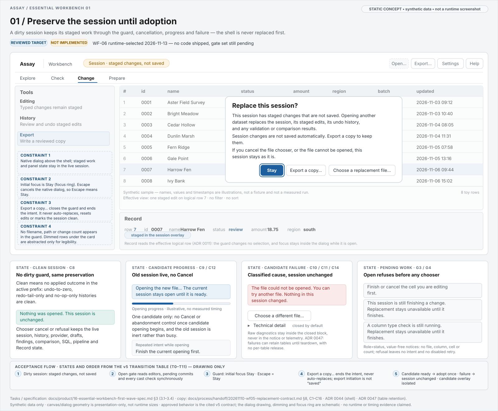
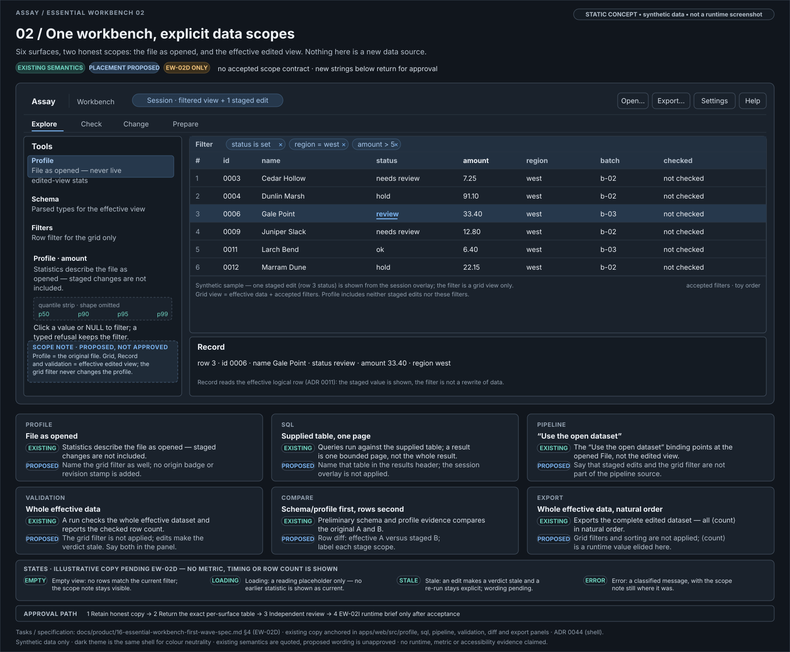
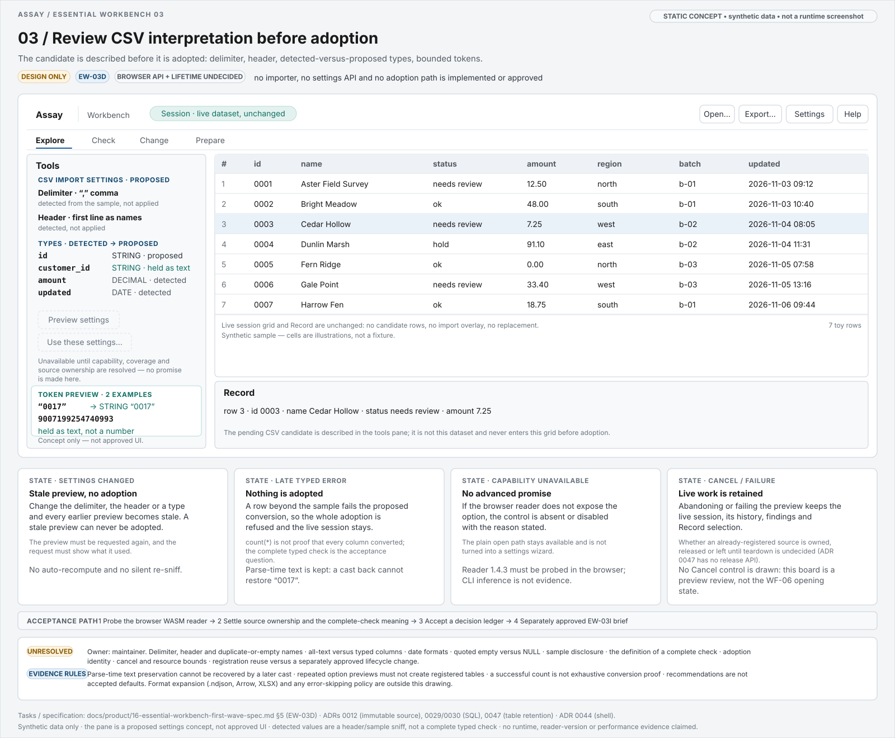
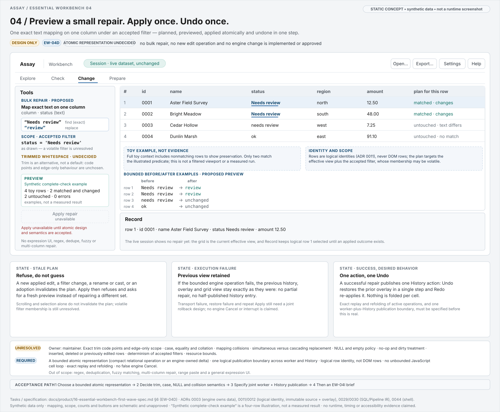

# Assay — essential-workbench visual pickup

**Date:** 2026-11-13. **Source baseline:** `55c255c`, clean at authoring start.
**Four static concept boards—not an interactive app, runtime screenshots, implementation evidence, or new scope approval.**
The maintainer commissioned these drawings to help the next agent understand the already-selected first
wave. All cells and counts are synthetic illustrations; no performance or usability measurement is shown.

## Start with the contract, then the drawing

1. [Current approval/task register and copyable agent briefs](../../../docs/process/handoff/20261113-essential-workbench-pickup.md).
2. [First-wave implementation specification](../../../docs/product/16-essential-workbench-first-wave-spec.md).
3. For replacement, the [full WF-05 v5 lifecycle/copy contract](../../../docs/process/handoff/20261110-wf05-replacement-contract.md),
   as narrowly clarified by specification IC-01…05.
4. Open the relevant SVG below. Return to the text contract for edge cases, exact copy, reservations and gates.

**Precedence:** accepted ADRs → dated selection → first-wave spec/clarifications → inherited v5 → these drawings.
If a drawing conflicts, correct the drawing or report it; never implement the easier pictured behavior.
The [older atlas](../README.md) remains broad historical vision, not a second execution queue.

WF-06 runtime is selected **but not implemented or preflight-verified by this pack**. EW-02D/03D/04D are
design-first assignments; their runtime successors remain blocked. Producing a drawing does not deliver
those technical contracts or choose their unresolved semantics. WF-06 need not wait for this artwork.

## Boards

| Board                                                  | Read it for                                                                            | Status and task                                                                    |
| ------------------------------------------------------ | -------------------------------------------------------------------------------------- | ---------------------------------------------------------------------------------- |
| [01 · Session replacement](01-session-replacement.svg) | Guard, preservation, export-first, progress, cancellation/failure and pending work     | **Reviewed behavior target, not shipped** — WF-06 / EW-01                          |
| [02 · Data scopes](02-data-scope.svg)                  | One shell, different input relations; candidate scope-label placement                  | **Existing semantic facts; proposed placement/copy** — EW-02D, not EW-02I approval |
| [03 · CSV interpretation](03-csv-interpretation.svg)   | Parse-time type intent, bounded preview and adoption blockers                          | **Design only; API/lifetime/coverage unresolved** — EW-03D                         |
| [04 · Bulk repair](04-bulk-repair.svg)                 | One-column exact mapping/trim concept, review, stale refusal, atomic apply/undo target | **Design only; semantics/representation unresolved** — EW-04D                      |

[](01-session-replacement.svg)

[](02-data-scope.svg)

[](03-csv-interpretation.svg)

[](04-bulk-repair.svg)

### Visual reading rules

- Each 1600×1320 canvas is a **presentation page including annotations**, not a fixed production viewport.
  The existing toolbar/task strip, tools-left pane, persistent grid and Record dock remain the reference.
  The task strip retains **Explore / Check / Change / Prepare**; Grid and Record are not extra tasks.
  No new dashboard, workbook tabs, formula bar, multi-document workspace or shell decision is proposed.
- Labels saying **reviewed target** refer to specified behavior, not a shipped feature. Labels saying
  **proposed/design only** do not approve strings, placement, APIs or operation defaults.
- Rectangles resembling buttons, inputs, dialogs and disclosure controls are drawings. They do not execute,
  model native modality, demonstrate keyboard/AT behavior or establish browser permissions.
- Any dark reference uses the same shell; it does not add a theme preference. Illustration colors, spacing,
  typography and focus-ring drawings are not new runtime tokens or pixel-perfect acceptance criteria.
- Actual implementation must preserve desktop-first geometry, the existing narrow stacked fallback,
  keyboard/focus behavior, both schemes and zoom. Rendering a large SVG is not proof of those app behaviors.
- Counts describe only toy examples. A shown preview is not an actual engine result, complete dataset check,
  benchmark or new telemetry event. No source filenames are used as shell/guidance copy. Toy dataset
  columns are not new app metadata. Board 04 deliberately shows nonmatching rows for context, not an actual
  filtered viewport; its “plan for this row” column is a preview annotation, not a new stored data field.

## 1. Replacement: visual anchors → executable requirements

SVG group IDs are illustration anchors, **not newly approved production test IDs**. Existing/new test names
below describe contract obligations; a reserved future test is not claimed to exist or pass.

| SVG anchor                | Meaning and authority                                                                                          | Required task proof                                                                            |
| ------------------------- | -------------------------------------------------------------------------------------------------------------- | ---------------------------------------------------------------------------------------------- |
| `replacement-guard`       | Dirty-only native-dialog target; exact C1–C7, Stay initial focus, Escape = Stay. Clean path has no dirty guard | Spec §3.1; v5 G/T1–T5, K18/K19; keyboard/modal and dirty/no-op/undo-to-zero cases              |
| `replacement-cancel`      | Chooser cancellation leaves the ready session intact; C8                                                       | T6; mocked-picker RTL for cancellation/refusal, not a claim Playwright dismisses an OS chooser |
| `replacement-progress`    | C9/C12; old session stays mounted but inert; no Cancel or declinable candidate after open begins               | A1/T7–T8, N6/N7/N11/N12; candidate-local overlay and atomic adoption                           |
| `replacement-failure`     | Classified C10, C11 retry and C14 technical-detail affordance; never reset live work on failure                | T9/T9b; N9/N16; IC-04: closed summary+pre, raw diagnostic outside live-announced text          |
| `replacement-pending`     | C13/C15/C16; editor or unsettled work refuses entry, not an automatic deferred chooser                         | G3/G4, N1–N5/N13–N17; IC-01/02: synchronous ref authority plus observable notice clearing      |
| `replacement-constraints` | Export-first ends intent; no automatic replacement, saved/autosave promise or finite retention bound           | Spec §3; v5 §6–§8; ADR 0047; source bytes/export behavior unchanged                            |

Approved visible replacement strings come from **v5 §8**, not this board's headings or annotations. C10
uses the classified unknown-cause example, “You can try another file.” Any production classifier must retain
its other approved causes too. C14's collapsed drawing does not hide or sanitize diagnostics by itself;
use the actual DOM/announcement/clipboard rules in IC-04. State cards are **alternative moments**, not
simultaneously displayed app dialogs or stacked live regions.

The concrete production/test reservation is [spec §3.4](../../../docs/product/16-essential-workbench-first-wave-spec.md#34-wf-06-file-reservation).
Browser/RTL limitations and full stock/configured/restored gates remain mandatory; do not replace them with
screenshot comparison. Relevant existing source: [App](../../../apps/web/src/App.tsx),
[DataGrid](../../../apps/web/src/grid/DataGrid.tsx),
[editing session](../../../apps/web/src/sessions/useEditingSession.ts),
[provider](../../../apps/web/src/grid/provider.ts).

## 2. Scope: facts to retain, presentation to decide

| SVG anchor         | Current semantic fact—not a new feature                                                           | EW-02D obligation                                                                                         |
| ------------------ | ------------------------------------------------------------------------------------------------- | --------------------------------------------------------------------------------------------------------- |
| `scope-grid`       | Effective overlay data under accepted grid filter/sort                                            | Distinguish accepted view from draft input and viewport/overscan; no new range wording by association     |
| `scope-profile`    | File as opened; not narrowed by edits or grid filtering                                           | Retain already-honest copy and numeric quantile/categorical meanings; no auto-profile or histogram claim  |
| `scope-sql`        | Supplied table name addresses original registered view; one displayed page is not the full result | No edited-view binding, origin stamp, result adoption or result export implied                            |
| `scope-pipeline`   | “Use the open dataset” obtains the retained original File                                         | Do not silently rebind to overlay or equate terminal outcomes with delivered artifacts                    |
| `scope-validation` | Effective whole dataset, not the grid filter; bounded failure evidence may be incomplete          | Preserve explicit rerun/stale handling and partial-sample refusal; no all-failures claim from sample rows |
| `scope-diff`       | Preliminary schema/profile: original A/B; confirmed-key row diff: effective A/B                   | Keep the mixed scope explicit; not an “all overlay-aware” panel or merge workflow                         |
| `scope-export`     | Complete effective dataset in natural order; filter/sort not applied                              | Preserve existing export disclaimer and delivery semantics; no subset/query output added                  |
| `scope-states`     | Initial/loading/empty/error/stale remain different states                                         | Return exact per-surface copy/state/placement/assertion table before EW-02I; draft wording is unapproved  |

Source/test evidence and already-shipped features are in
[comparison §4](../../../docs/reviews/2026-11-12-essential-workbench-comparison.md#4-assay-baseline-existing-functionality-versus-gaps).
The board does not define new run provenance. EW-02D may recommend **retain** everywhere existing labels
are sufficient. WFD-03/07, D-11 and WF-O1/O2 remain separate decisions.

## 3. CSV: the preview is not the adopted dataset

| SVG anchor          | Proposed design intent                                                                     | Must be resolved in EW-03D                                                                                                           |
| ------------------- | ------------------------------------------------------------------------------------------ | ------------------------------------------------------------------------------------------------------------------------------------ |
| `csv-controls`      | Advanced delimiter/header/type review alongside the existing simple-open path              | Supported browser option allowlist, API exposure, quoting, defaults and actual placement/copy                                        |
| `csv-token-preview` | Preserve a source token such as `0017` or a large identifier **at parse time**             | Types/all-text semantics, NULL versus empty, ambiguous dates; a cast-back cannot restore a lost lexeme                               |
| `csv-live-session`  | Current main grid/Record stays the live session while review is provisional                | Registration ownership, cancel/failure/abandon/adoption, candidate isolation and late-result handling                                |
| `csv-states`        | Settings change, late conversion failure and unavailable capability are different blockers | Sample versus complete typed evaluation, stale invalidation, refusal and resource/failure behavior                                   |
| `csv-decisions`     | No fictitious ready-to-use browser importer API                                            | Probe pinned browser WASM, not CLI alone; `count(*)` alone is not typed-column validation; no extra registrations/release assumption |

The control arrangement is a **candidate concept**, not a delivered CSV contract or runtime reservation.
A source-token preview remains local and bounded; it does not replace the live grid or promise every row
was parsed. Any pictured final action remains unavailable while the technical/semantic gates are unresolved.
No silent skip-bad-row, automatic locale inference, `.ndjson` alias change, new format or engine Cancel is
selected. In particular, a concept of backing out of a pre-adoption review is not permission to add Cancel
to WF-06's `opening-candidate` state. Read [spec §5](../../../docs/product/16-essential-workbench-first-wave-spec.md#5-ew-03d--csv-interpretation-contract-not-importer-implementation).

## 4. Bulk repair: the atomicity claim must be designed, not drawn into existence

| SVG anchor         | Proposed design intent                                                                              | Must be resolved in EW-04D                                                                             |
| ------------------ | --------------------------------------------------------------------------------------------------- | ------------------------------------------------------------------------------------------------------ |
| `repair-controls`  | One scalar text column; exact mapping or a separately specified edge trim                           | Exact whitespace, comparison/case/collation, NULL/empty, collisions, simultaneous/cascading policy     |
| `repair-preview`   | Before/after examples and separately identified impact evidence                                     | Complete safety/affected counts versus bounded examples; no sample-as-proof or silent top-N            |
| `repair-grid`      | Logical row targets in whole effective data or accepted filter, including offscreen rows            | Prior edits/inserts/deletes/rename/cast, stable membership, no DOM-index targeting                     |
| `repair-stale`     | Data/schema/history cursor/predicate change invalidates the reviewed plan; scrolling alone does not | Volatile SQL predicates, captured identity/revision/schema, execution preconditions and repeated Apply |
| `repair-failure`   | Desired failure outcome preserves old effective data and History, not partial cell changes          | Joint worker/host publication, transport failure, rollback/restore failure, resource refusal           |
| `repair-history`   | Desired successful repair is one undoable History action with exact undo/redo                       | Compact representation, refolding/branching and no-op/dirty semantics; no per-cell JS loop             |
| `repair-decisions` | Safe concept boundaries, not approved operation defaults                                            | Return the representation/semantics/test decision ledger before any runtime row                        |

The mapping example is synthetic and **not** approval of a case, NULL, trim or collision policy. Any toy
complete-check counts are internally illustrative only; they are not probe output. An atomic apply/undo
state strip depicts the required future outcome, not evidence that the current EditOp union supports it.
If bounded atomicity cannot be established, reduce/split scope and return for approval. No regex, dedupe,
fuzzy matching, formula engine, arbitrary scripting, multi-column repair, range paste or true interrupt
promise. Read [spec §6](../../../docs/product/16-essential-workbench-first-wave-spec.md#6-ew-04d--deterministic-scalar-text-repair-contract-not-a-per-cell-loop).

## 5. How another agent should use these boards

1. Claim only a task authorized in the first-wave register; verify current clean baseline and its delta.
2. Read its text contract and this board's status/anchor map. Treat geometry as illustrative.
3. For EW-02D/03D/04D, return the missing copy/semantics/API/ownership/atomicity contract; do not code an
   apparently small pictured control before those gates are resolved.
4. For WF-06, use exact copy and the full G/T/N/K + IC acceptance set, named reservation, independent
   reviewer and fresh runtime gates. Rendering this drawing is not EW-00 or a product test.
5. Preserve source bytes, existing scope/export behavior, privacy and accepted shell. Report conflicts.

## 6. Artwork verification boundary

The four SVGs are intended to be self-contained XML/vector documents: system fonts, no scripts, external
fonts/images, event handlers, foreignObject, network references or embedded execution. Root title/desc
provide a text alternative for each static page. This is not an interactive keyboard/AT prototype.

Validation covers XML parsing/unique IDs/title references, static-resource safety, displayed approved-copy
consistency and actual browser rendering/text bounds. Browser screenshots/diagnostics are temporary local
evidence, not runtime screenshots committed to this pack. Documentation gates cover format/relative links/
ADR index; no full application runtime suite is required or claimed for static design files. RD-T07,
native chooser coverage, engine-resource/atomicity questions and all unselected feature gates remain unchanged.

## 7. Observed verification and independent review

Independent `openai-codex/gpt-6-luna` review at explicit **xhigh** returned **APPROVE**, with no critical,
warning or suggested changes. It inspected the four rendered pages, their source, task/copy boundaries and
README mapping. Approval applies only to the static visual pack—not product implementation or new scope.

| Check                   | Observed result                                                                                                                                                                                                                                              |
| ----------------------- | ------------------------------------------------------------------------------------------------------------------------------------------------------------------------------------------------------------------------------------------------------------ |
| XML/static safety       | Four parseable SVGs, unique IDs and valid title/desc references; 26 mapped board anchors; no script, external resource, event handler, image or foreignObject. The local drop-shadow filter has no external dependency                                       |
| Replacement copy        | **16/16** displayed C1–C16 blocks match v5 after whitespace normalization; C10 uses the documented unknown-cause variant                                                                                                                                     |
| Browser rendering       | All four actual SVG sources rendered at 1600×1320 with system fonts, in a temporary local HTML inspection wrapper; final text bounds showed **0 outside-canvas boxes / 0 unintended text-box intersections**, excluding intentional modal-underlay occlusion |
| Browser console/network | Zero errors/warnings on the four final pages; no external resource requests; only the local favicon request (204)                                                                                                                                            |
| Artwork formatting      | Explicit Prettier HTML-parser check on all four SVGs passes                                                                                                                                                                                                  |
| Documentation           | Root format, relative-link check (**150 files / 0 broken**), ADR index (**47 records**) and diff checks pass; this asset README's **24 relative targets** were checked separately, including fragments                                                       |

Initial inspection found generic tool tabs, a sort indicator inconsistent with toy row order, and several
actual-font annotation collisions. These were corrected in the drawings (including restoring the existing
four tasks), then all four pages were rendered again. No runtime behavior or gate threshold was changed.
The first CLI navigation to a standalone SVG fetched HTTP 200 but timed out in its HTML-body-oriented
inspection path; rendering the unchanged vector source inside a temporary local HTML wrapper resolved that
tooling issue without increasing a timeout. An initial ad-hoc XML whitelist was corrected to admit the
pure local drop shadow, and SVG formatting uses an explicit HTML parser rather than unsupported extension
inference. These were inspection-tool corrections, not hidden product-test retries.

Temporary evidence: `/tmp/assay-essential-svg-evidence/final/` (PNGs, browser text bounds, console/request
logs); prior captures and the standalone-navigation failure remain outside the repository. Static/copy
checks were captured in `/tmp/assay-essential-svg-static.json`. These are local audit aids, not required
inputs for a future agent. Screenshots and helper scripts are not committed.

From the repository root, reproduce the formatting/documentation gates with:

```bash
pnpm exec prettier --check --parser html assests/svg/essential-workbench/*.svg
pnpm format:check
pnpm docs:links:check
pnpm adr:index:check
git diff --check
```

Inspect the SVGs in a browser/vector editor too; passing XML or formatting alone does not establish text
fit, scope honesty or accessibility. No application build/unit/e2e suite, participant/AT session, full
runtime baseline, implementation, push or publication was performed for this static pack.
